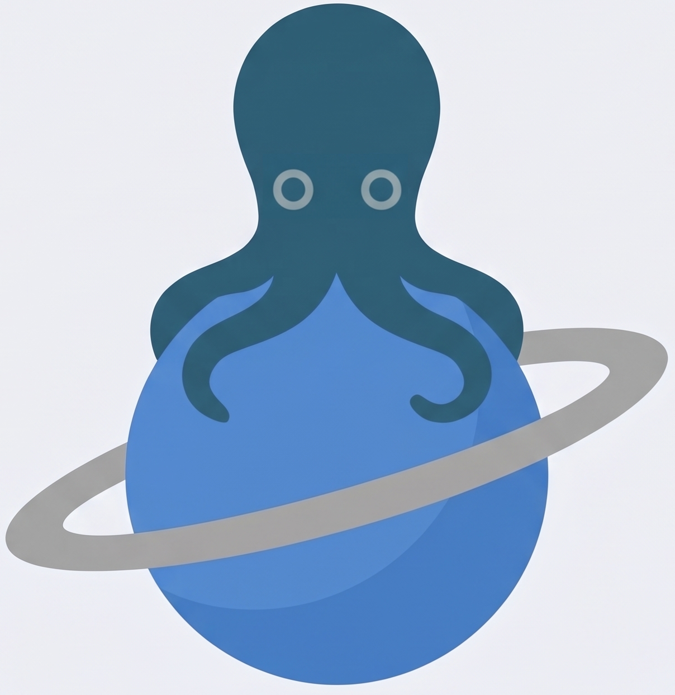

# 🪐 Saturn YAUL Studio (YAUL Engine & Editor)



**Saturn YAUL Studio** is a complete C++ game engine and visual editor for
Windows, inspired by Unity and focused on developing native **Sega
Saturn** games using the open-source **`libyaul`** (*Yet Another Saturn
Library*) library.

The tool abstracts the complexity of Sega hardware --- dual **Hitachi
SH-2 (Big-Endian)** processors, **VDP1** (Sprites/Polygons), **VDP2**
(Background Planes/Tilemaps), **SCU DMA**, and **SMPC** (Input) --- into
a productive visual interface. With a single shortcut (**F5**), the
editor converts textures and maps, generates the scene's C code,
attaches the user's logic scripts, invokes the `sh2eb-elf-gcc`
cross-compiler, creates the `.iso`/`.cue` image, and launches the game
directly in the emulator, where it responds to controller input.

------------------------------------------------------------------------

## ✨ Editor and Engine Features (What Is Already Running)

### 1. Project and Environment Management (`Top Menu`)

-   **New Project:** Automatically creates the game's directory
    structure (`assets/scenes`, `assets/textures`, `assets/tilesets`,
    `assets/maps`, `scripts/`, `build/`), including base files and an
    initial configuration ready to compile.
-   **Open Project:** Loads existing projects, restoring the main scene
    and reconnecting texture, map, and script references.
-   **Preferences:** Persistent configuration for environment paths (the
    location of the `yaul-win64` SDK, the preferred Sega Saturn emulator
    executable, and runtime/build parameters).

### 2. Scene System (`Root Scene` & `.scn`)

-   **Scene Management:** Supports creating, saving, and loading scene
    files (`.scn`).
-   **Root Scene:** The root scene organizes the world's global state,
    background clear color (`Clear Color`), active main camera, and the
    ordered list of all entities to be exported to the console's memory.

### 3. Hierarchy and Entity System (`Entity`)

A complete hierarchy panel for creating, renaming, duplicating,
deleting, and selecting scene objects. The engine supports five native
Saturn archetypes:

-   **`VDP1_Quad`:** Four-vertex polygons with solid RGB1555 colors,
    rendered by the VDP1 chip. Useful for platforms, visible collision
    boxes, simple UI, and prototyping.
-   **`VDP1_Sprite`:** Textured sprites
    (`vdp1_cmdt_distorted_sprite_set`), with automatic PNG-to-RGB555
    binary conversion and transfer to VRAM via SCU DMA.
-   **`VDP2_Plane`:** Hardware background/scene layer (`NBG0`),
    supporting Tiled `.png` tilesets and `.json` maps, independent X/Y
    parallax factors, and a scene collider.
-   **`Camera`:** A 2D/3D world-view controller supporting target
    tracking (*Follow X/Y*), fixed-point smoothing (*Smoothness*), a
    dead zone (*Deadzone*), and scene limits (*Camera Bounds Min/Max*).
-   **`Empty`:** An invisible logical object for grouping, spawn
    markers, or running global scripts.

### 4. Interactive Viewport (2D / 3D) with Gizmos

-   Real-time visualization of the game world, with switching between 2D
    and 3D camera modes (`H`, `T`, `R`, `S`, `2D`).
-   **Transform Gizmos:** Visually manipulate position (`Translate`),
    rotation (`Rotate`), and scale (`Scale`) directly with the mouse.
-   **Saturn Camera Frame:** A blue guide rectangle projected in the
    viewport, showing the exact native Sega Saturn display area at **320
    × 224 pixels**.
-   **Visual Collider Debugging:** Displays green bounding boxes on
    entities with active AABB collision and around each solid cell in
    the VDP2 tilemap.

### 5. Full Inspector

Real-time editing of all components belonging to the selected entity:

-   **Transform:** Position `(X, Y, Z)`, rotation, and scale
    (automatically converted to `fix16_t` in the generated C code).
-   **Rendering:** Base color, drawing priority (VDP1 Z-order), and the
    `Visible` flag.
-   **Textures and Tilesets:** Integrated file selectors that
    automatically run the binary converters when an asset is changed.
-   **2D Physics (AABB):** `Collider` activation, `Is Trigger` mode (an
    event sensor that does not block movement but triggers actions),
    `Collider Size`, and `Collider Offset`.

### 6. Logic and Scripting System (Behavior and Console Input)

-   **Script Assignment (`scriptName`):** Any entity can be assigned a C
    script through the Inspector (e.g., `player_controller`,
    `camera_controller`).
-   **Automatic Lifecycle (`init` / `update`):** The Saturn Studio
    exporter automatically generates the required headers and inserts
    initialization and per-frame update calls into the SH-2 main loop.
-   **Real Controller Input (`smpc_peripheral_digital_t`):** Scripts
    receive the updated state of the Sega Saturn controller
    (`PERIPHERAL_DIGITAL_LEFT`, `RIGHT`, `UP`, `DOWN`, `A`, `B`, `C`,
    `START`, etc.). This makes it possible to move the character, test
    physics, trigger events (such as changing a sensor's color when
    touched), and control the camera directly in the emulator.

------------------------------------------------------------------------

## 🎨 Tileset, Map (VDP2), and Scene Collision Pipeline

One of the project's biggest completed technical milestones is the
automated pipeline for the **VDP2** chip:

1.  **Automatic Tileset Converter (`.png` → `.cpd.bin` + `.pal.bin`):**
    -   When a `.png` file is selected in the `VDP2_Plane` Inspector,
        the editor slices the image into **8 × 8 pixel** cells.
    -   **256-Color Mode (8 bpp):** Generates 64 bytes per tile (with
        Tile `0` forced to 64 transparent bytes of `0x00`) and a
        512-byte palette in native **RGB1555 Big-Endian** format,
        setting the opacity bit `0x8000` for usable colors and `0x0000`
        for the transparent index.
2.  **Automatic Tiled Map Converter (`.json` → `.bin`):**
    -   Reads the `.json` file exported by the *Tiled Map Editor* (64 ×
        64 cells / 512 × 512 px) and generates **1-Word Pattern Name
        Data (PND)** binary data in **Big-Endian** format, multiplying
        tile indices by 2 (`tileVal * 2`) to match VDP2's 64-byte
        character addressing in 8 bpp mode.
3.  **Scroll and Hardware Synchronization:**
    -   Automatically configures VRAM cycle banks (`CYCP` Bank A0 with 8
        `CHPNDR_NBG0` accesses and Bank B1 with `PNDR_NBG0`).
    -   Loads the palette directly into `CRAM` as 16-bit words
        (`volatile uint16_t *`) and enables the plane with the
        transparency channel (`VDP2_SCRN_DISPTP_NBG0`).
    -   Applies mathematical scroll compensation (`+96` px on X, `+144`
        px on Y, and Y-axis inversion) so that the viewport center
        `(0,0)` corresponds exactly to the center of the **320 × 224**
        TV display.
4.  **2D Tilemap Collider (O(1) on the SH-2):**
    -   Performs very fast checks by converting the player's four
        collider corners into coordinates in the map matrix stored in
        memory (`vdp2_map_data`). Movement is blocked on tiles within
        the `Solid Tile Min` / `Solid Tile Max` range, and logical
        wrapping can be enabled or disabled (`Repeat / Wrap Map`).

------------------------------------------------------------------------

## ⚠️ Current Status: Limitations and Known Issues

The engine is **fully functional end to end**: create a project, build a
scene, import textures and Tiled maps, program the player script, press
**F5**, and play in the emulator with collision and camera behavior
working.

The remaining issues for upcoming iterations are:

1.  **VDP2 Plane Visual Repetition (Hardware Wraparound):**
    -   The collider ignores collisions outside the 512 × 512 area when
        `Repeat / Wrap Map` is disabled. However, the VDP2 chip
        inherently repeats the plane visually if the camera scrolls
        beyond its edges. Current workarounds are enabling `Use Bounds`
        on the `Camera` entity or filling the map edges with Tile 0
        (transparent).
2.  **Debug-Line Orientation in the Viewport (Rear View):**
    -   In the editor viewport, when orbiting the 3D camera to view the
        scene from behind, the green *Tilemap Collider* outline
        (`DrawRectangleLinesEx`) appears vertically inverted (upside
        down) because of the difference between Raylib's 2D drawing
        orientation and 3D space.
3.  **Fixed VDP2 Parameters: 8 bpp / 1x1:**
    -   The current generation pipeline is fixed to 256 colors (8 bpp)
        and a `1x1` plane (512 × 512 px).

------------------------------------------------------------------------

## 🚧 Roadmap (Remaining Work)

-   [ ] **Advanced VDP2 Options in the Inspector:**
    -   User-selectable color depth: **4 bpp (16 colors)** vs. **8 bpp
        (256 colors)**.
    -   Native plane-size selector: **`1x1`** (512 × 512), **`2x1`**
        (1024 × 512), and **`2x2`** (1024 × 1024).
-   [ ] **Tilemap Streaming (Huge Levels Like *Sonic*):**
    -   Load maps of arbitrary width into Work RAM (2 MB) and use VDP2
        VRAM as a circular buffer ("sliding window"), transferring new
        columns/rows via CPU/DMA every 8 pixels of camera movement. Also
        render the entire extended map in the editor viewport.
-   [ ] **3D Tilemap Collider Gizmo Fix:** Draw the grid's green boxes
    using 3D primitives (`rlBegin(RL_LINES`) so they remain aligned at
    any camera angle.
-   [ ] **Multiple Background Planes (`NBG1`, `NBG2`)** and **VDP1
    Spritesheet Animation**.
-   [ ] **Audio Subsystem (SCSP / PCM / CD-DA).**

------------------------------------------------------------------------

## 🛠️ Prerequisites and Dependencies

To build **Saturn Studio** and generate **Sega Saturn** games, you need
to install:

### 1. To Build the Editor (Windows x64)

-   **Operating System:** Windows 10 or 11 (64-bit).
-   **Visual Studio 2019 or 2022** with the **Desktop development with
    C++** workload (MSVC `cl.exe` compiler with C++17 support).
-   **CMake** (3.16 or later), available in the `PATH`.
-   **Editor Libraries (included/managed through CMake in the
    project):**
    -   **Raylib (`raylib` / `rlgl`):** OpenGL rendering for the
        viewport, textures, and images.
    -   **Dear ImGui (`imgui`) + `rlImGui`:** Graphical interface for
        windows, menus, Hierarchy, and Inspector.

### 2. To Build Sega Saturn Games (Target SDK)

-   **YAUL Toolchain (`C:\\yaul-win64`):**
    -   Integrated **MSYS2 / Cygwin** environment (provides `make`,
        `bash`, and POSIX utilities).
    -   **`sh2eb-elf` GCC cross-compiler** (`sh2eb-elf-gcc`,
        `sh2eb-elf-ld`, `sh2eb-elf-objcopy`) for the Hitachi SH-2
        Big-Endian architecture.
    -   Precompiled **`libyaul`** library (modules `vdp1`, `vdp2`,
        `scu`, `smpc`, `gamemath/fix16`).
    -   CD image tools (`mkisofs` / `xorriso`) and the build script
        `C:\\yaul-win64\\scripts\\saturn_make.bat`.
-   **Sega Saturn Emulator:** Yabause, Kronos, Mednafen, or YabaSanshiro
    (configured in the editor's *Preferences* menu).
-   **Tiled Map Editor:** For creating and exporting maps as `.json`.

------------------------------------------------------------------------

## 🚀 Step-by-Step Build and Test Instructions

### Step 1: Build Saturn Studio (Editor)

Open the **x64 Native Tools Command Prompt for VS 2019/2022**, navigate
to the `editor` directory, and run:

``` cmd
cd D:\\Desenvolvimento\\Engine\\saturn-yaul-studio\\editor
cmake -B build -S .
cmake --build build --config Release
```
